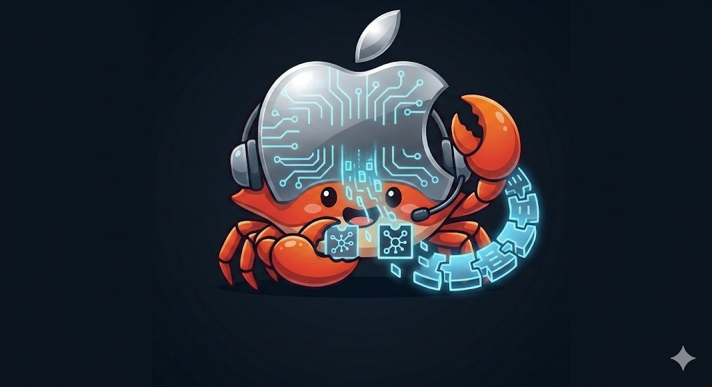

# idevice-rs

<p align="center">
  
</p>

Pure-Rust toolkit for talking to **iOS / iPadOS** devices over the **Apple USB mux** protocol — both from a native CLI and from a Chromium tab via **WebUSB + WASM**. Roughly the same job as the libimobiledevice family of tools (`ideviceinfo`, `idevicepair`, `idevicesyslog`, `idevicecrashreport`, `pymobiledevice3 pcap`), but with no usbmuxd dependency in the default flow.

```
+--------------+   USB cable    +------------------------+
|   iPhone     |  ============  |  Linux / macOS host    |
|  lockdownd   |  Apple mux v2  |                        |
|  (port 62078)|                |   idevice-cli (native) |
+--------------+                |   ─ or ─               |
                                |   Chromium (WebUSB)    |
                                +------------------------+
```

---

## Features

### Native CLI (`idevice-cli` → `idevice`)

| Command | Equivalent | What you get |
|---------|-----------|--------------|
| `list` / `connect` / `mux` | — | USB enumeration, descriptors, raw mux smoke test. |
| `pair` | `idevicepair pair` | Generate RSA host chain → `Pair` → poll Trust → save a libimobiledevice-shape record. |
| `battery` / `run` / `diagnostics` | `ideviceinfo` | Sectioned `GetValue` snapshot (Identity, Network, Cellular, Locale, Activation, Storage, Battery). |
| `syslog` | `idevicesyslog` | Live `com.apple.syslog_relay` to stdout / file. |
| `pcap -o FILE` | `pymobiledevice3 pcap` | RVI traffic decoded into a libpcap file Wireshark / `tcpdump -r` open directly. |
| `crash-reports DIR` | `idevicecrashreport` | `crashreportmover` + AFC `crashreportcopymobile`, with substring filter and delete-on-device modes. |

### Browser demo (WebUSB + WASM)

The `web/index.html` page runs everything above **inside Chromium**, except the usbmuxd Unix-socket fallback (which doesn't apply in the browser). You get a polished UI per action with status pills, a live syslog stream pane, a per-packet **network capture dissector** (Ethernet → IP → TCP/UDP/DNS/TLS-SNI/HTTP, click to expand + hex dump), and per-file crash-report download buttons. Pair records exported by the page are byte-compatible with `idevicepair` / `pymobiledevice3` — pair once, reuse anywhere.

### Library (`idevice` + `idevice-usb-core`)

Reusable crates if you want to build your own client: USB mux v2 framing, `TcpConn`, lockdown plist helpers, rustls-based pairing/TLS, AFC, and per-service decoders (syslog framing, `pcapd_proto`, and related helpers). Same code paths run on `wasm32-unknown-unknown`.

---

## Prerequisites

- **Rust** stable + Cargo
- **libusb** (Linux: `libusb-1.0-0-dev`)
- For the browser demo: a Chromium-based browser (Chrome / Edge / Brave / Arc / Opera) served over **HTTPS or `http://localhost`** (WebUSB is blocked on `file://` and over plain HTTP on a LAN IP).

> **Linux + usbmuxd**: if the system `usbmuxd` already owns the device, the CLI silently falls back to its Unix socket for `pair` / `battery` / `diagnostics` (override with `USBMUXD_SOCKET_PATH`). `syslog`, `pcap`, and `crash-reports` need a **second** mux pseudo-TCP and therefore exclusive USB — `sudo systemctl stop usbmuxd` for those, or use the corresponding libimobiledevice tool. **Chromium** can't talk to `usbmuxd` at all, so the browser tab needs raw USB access either way.

---

## Build

```bash
cargo build                 # workspace (CLI + libs)
./scripts/build-wasm.sh     # browser demo (web/pkg/)
```

The WASM bundle is **not** built by default — `web/pkg/` is gitignored, so rebuild after a fresh clone.

---

## CLI quick start

```bash
# 1. Discover the device
cargo run -p idevice-cli -- list

# 2. Smoke-test mux + pseudo-TCP to lockdownd (no pairing yet)
cargo run -p idevice-cli -- mux

# 3. Pair (unlock the iPhone, accept "Trust this computer", type passcode)
#    Saves $XDG_CONFIG_HOME/idevice-rs/pair-records/<UDID>.plist
cargo run -p idevice-cli -- pair

# 4. Anything afterwards auto-loads the saved record — no more Trust prompt.
cargo run -p idevice-cli -- battery
cargo run -p idevice-cli -- diagnostics
cargo run -p idevice-cli -- syslog -o ./iphone.syslog
cargo run -p idevice-cli -- pcap -o capture.pcap --max-packets 200
cargo run -p idevice-cli -- crash-reports ./crashes --filter SpringBoard
```

`cargo run -p idevice-cli -- <CMD> --help` prints full clap help. The cache layout matches `idevicepair` / `pymobiledevice3`, so the same plist works with `--pair-record /var/lib/lockdown/<UDID>.plist` (after copying it) or with the browser tab.

### Reusing existing pair records

```bash
# Use libimobiledevice / usbmuxd records on Linux without re-pairing
cargo run -p idevice-cli -- battery --pair-record-dir /var/lib/lockdown

# Or a single explicit file
cargo run -p idevice-cli -- battery --pair-record /path/to/UDID.plist

# Force a fresh Pair (ignore the auto-cache)
cargo run -p idevice-cli -- pair --no-auto-pair-record-cache
```

### Live pcap

```bash
# Capture to a file
cargo run -p idevice-cli -- pcap -o capture.pcap --max-packets 500

# Stream into tcpdump / Wireshark — '-o -' swaps stdout→stderr for status messages
cargo run -p idevice-cli -- pcap -o - --quiet | tcpdump -r - -nn
cargo run -p idevice-cli -- pcap -o - --quiet | wireshark -k -i -

# Filter Safari over cellular only
cargo run -p idevice-cli -- pcap -o safari-cell.pcap \
    --filter-process mobilesafari --filter-interface pdp_ip0
```

### Common flags

| Flag | Default | Effect |
|------|---------|--------|
| `--serial STR` | first device | Pick a specific Apple device by USB serial. |
| `--pair-record PATH` / `--pair-record-dir DIR` | auto-cache | Load pair record from a file, or `DIR/<USB-serial>.plist`. |
| `--save-pair-record PATH` / `--no-save-pair-record` | auto-save | Override / disable the auto-save after `Pair`. |
| `--pair-trust-timeout-secs SECS` | `120` | Total time to wait for Trust prompt + passcode. |
| `--lockdown-tls-client-auth {host,root,chain}` | `host` | Client cert presented after `EnableSessionSSL`. Use `root` for libimobiledevice-shaped records. |
| `--lockdown-tls-sni {device,none}` | `device` | TLS SNI; `none` matches libimobiledevice. |
| `--lockdown-tls-debug` | off | Verbose TLS handshake / pairing crypto trace. |

Full reference: see [Technical reference](#technical-reference) below.

---

## Browser demo quick start

```bash
./scripts/serve.sh                  # rebuild WASM + serve on http://127.0.0.1:8080
# (or)
SKIP_WASM_BUILD=1 ./scripts/serve.sh  # static-only reload
```

Open **`http://127.0.0.1:8080/`** in Chrome / Edge / Brave / Arc / Opera. The page is laid out as four steps:

1. **Pick device** (`navigator.usb.requestDevice` with Apple VID `0x05ac`).
2. **Pair record** — generate one (`Random` / `Legacy` host RSA), or drop in a libimobiledevice / CLI plist. Auto-cached in `localStorage`.
3. **Run an action** — Lockdown queries (Battery, Diagnostics, Fetch with plist), Syslog stream, **Network capture**, Crash reports. Each card has its own status pill, options drawer, and result pane.
4. **Output log** — timestamped trace + verbose toggle.

The **Network capture** card builds a libpcap blob in memory (default 32 MiB cap, all other limits unbounded), shows a live dissector table with colored protocol tags, click-to-expand layered inspector + hex dump, an inline quick-filter, and a one-click resume when a limit kicks in. Decoding uses inline JS for L2-L4 plus [`dns-packet`](https://www.npmjs.com/package/dns-packet) lazy-loaded from `esm.sh` for proper DNS dissection.

If the page warns **"WebUSB unavailable"**, the URL is the most likely culprit — `http://127.0.0.1:8080/` and `http://localhost:8080/` both work, but `file://`, plain `http://192.168.x.x/`, Firefox, and Safari do not.

---

# Technical reference

The rest of this README documents the protocol, framing, and design decisions in `idevice-rs`. Skip it unless you're debugging a wire-level issue or porting the stack.

## Architecture overview

Apple exposes a **USB multiplexing** protocol on a vendor interface: the host wraps **IPv4-style TCP** segments inside USB bulk transfers. **lockdownd** listens on TCP port **62078**. The Rust stack implements the framing in `idevice-usb-core`, then `idevice` speaks lockdown XML plists (length-prefixed) over the resulting byte stream.

```
  +-----------+  USB cable   +-----------------------------+
  |  iPhone   |<============>|  Host OS + libusb (rusb)    |
  | lockdownd |              |  OR usbmuxd socket (Linux)  |
  +-----+-----+              +--------------+--------------+
        |                                    |
        |   Apple USB mux interface          |
        |   (bulk IN/OUT, mux packets)       |
        v                                    v
  +-------------------+              +-------------------+
  | libusb path       |              | usbmuxd path      |
  | MuxLink (USB)     |              | SocketMuxLink     |
  +---------+---------+              +---------+---------+
            |                                    |
            +----------------+-------------------+
                             v
                    +----------------+
                    |  pseudo-TCP    |  dport 62078 → lockdownd
                    +--------+-------+
                             |
                             v
                    +----------------+
                    |  lockdownd     |  cleartext, then TLS 1.2/1.3
                    +----------------+
```

**Cleartext first**: `QueryType`, `Pair`, some `GetValue`, `StartSession`. **Then TLS**: when `StartSession` returns `EnableSessionSSL`, the same TCP connection carries TLS (rustls in `idevice`) for `GetValue`, `StartService`, AFC, and so on.

### Linux: direct USB vs usbmuxd

```
  try open_apple (libusb)
           │
           ▼
     ┌─────┴─────┐
     │ success?  │
     └─────┬─────┘
       │       │
      yes      no  (Resource busy on Linux)
       │       │
       ▼       ▼
  MuxLink   SocketMuxLink ─► usbmuxd ─► iPhone
  (USB)     (Unix socket)    daemon     USB owned by daemon
```

The usbmuxd fallback **does not** open a second mux TCP today, so `syslog` / `pcap` / `crash-reports` still need raw USB even when `pair` / `battery` work via the socket.

## Mux v2 framing (the bytes on the wire)

Every USB bulk transfer is one **mux packet**. `idevice-usb-core` speaks **mux v2**, the version negotiated against current iOS:

```
   0                   1                   2                   3
   0 1 2 3 4 5 6 7 0 1 2 3 4 5 6 7 0 1 2 3 4 5 6 7 0 1 2 3 4 5 6 7
  +-+-+-+-+-+-+-+-+-+-+-+-+-+-+-+-+-+-+-+-+-+-+-+-+-+-+-+-+-+-+-+-+
  |  protocol (u8)  |   reserved (u8)   |  tx_seq (u16, big-endian) |   ← v2 header
  +-+-+-+-+-+-+-+-+-+-+-+-+-+-+-+-+-+-+-+-+-+-+-+-+-+-+-+-+-+-+-+-+
  |              followed by a TCP-style header (sport,             |
  |              dport, seq, ack, flags, window, …) and payload     |
  +-----------------------------------------------------------------+
```

`tx_seq` is a per-direction `u16` counter that **must increment by one for every packet** — lockdownd silently drops out-of-order frames. `MuxHub::connect_tcp_initial` runs `VERSION` / `SETUP` once per session; subsequent `connect_tcp_additional` calls reuse the hub so a single USB interface can carry **lockdownd**, **crashreportmover**, **syslog_relay**, **pcapd**, and **AFC** simultaneously.

## Pairing (`InvalidPairRecord`-proof)

```
     Host (idevice / idevice-wasm)                  Device (lockdownd:62078)
     ───────────────────────────────                ────────────────────────
                       │   QueryType                              │
                       │ ───────────────────────────────────────► │
                       │   ServiceVersion                         │
                       │ ◄─────────────────────────────────────── │
                       │   GetValue("DevicePublicKey")            │
                       │ ───────────────────────────────────────► │
                       │   <data> (PKCS#1 RSA pubkey)             │
                       │ ◄─────────────────────────────────────── │
   build cert chain    │                                          │
   (root, host, device)│   Pair { PairRecord, PairingOptions:     │
   sign DevicePub      │          { ExtendedPairingErrors=true } }│
                       │ ───────────────────────────────────────► │
                       │   Error: PairingDialogResponsePending    │
                       │ ◄─────────────────────────────────────── │
                       │       (Trust prompt shown on device)     │
                       │  ⏳ poll on the SAME mux TCP (≥ 15 s)    │
                       │   Pair { PairRecord, … }                 │
                       │ ───────────────────────────────────────► │
                       │   { EscrowBag, WiFiMACAddress, HostID }  │
                       │ ◄─────────────────────────────────────── │
                       │   StartSession { HostID, SystemBUID }    │
                       │ ───────────────────────────────────────► │
                       │   { SessionID, EnableSessionSSL: true }  │
                       │ ◄─────────────────────────────────────── │
                  ╔════╧═════════════════════════════════════════╤╗
                  ║  TLS handshake (rustls)                       ║
                  ║   ClientHello (SNI=device, no resumption)     ║
                  ║   ServerHello, Cert (DeviceCertificate)       ║
                  ║   Cert (HostCertificate) + ClientKeyExchange  ║
                  ║   Finished, Finished                          ║
                  ╚════╤═════════════════════════════════════════╧╝
                       │   GetValue / StartService / AFC … (TLS)  │
                       │ ◄────────────────────────────────────► … │
```

The whole loop runs on the **same** lockdown pseudo-TCP — re-opening it between `Pair` retries makes lockdownd drop the in-flight pair state and reply `InvalidPairRecord`, which is why `--reopen-lockdown-between-pair-retries` is **off** by default.

### `Pair` plist invariants (libimobiledevice canonical shape)

Five subtle invariants in the `PairRecord` dict matter — getting any of them wrong yields `InvalidPairRecord` after the user accepts Trust, instead of a clean `EscrowBag` reply:

| # | Rule | Why it matters |
|---|------|----------------|
| 1 | Certs and keys go in `<data>` (**CFData**), never `<string>`. | lockdownd type-checks values *after* the Trust dialog; a `<string>` parses fine but trips `InvalidPairRecord` on iOS ≥ 14. |
| 2 | `HostID` / `SystemBUID` are **UPPERCASE UUIDv4**. | Matches libimobiledevice `generate_uuid()` and `usbmuxd`'s on-disk format. Lowercase fails silently on some builds. |
| 3 | `RootPrivateKey` is **stripped** before send. | Host secret. libimobiledevice keeps it locally only; sending it triggers a deferred `InvalidPairRecord`. |
| 4 | No top-level `HostName`. | libimobiledevice keeps `HostName` only in the locally-saved record. |
| 5 | No `WiFiMACAddress` in the request. | The device echoes its WiFi MAC in the reply; sending it pre-emptively confuses lockdownd on direct USB. |

The certificate chain (rcgen + rsa) uses **`serial = 0`** for all three certs to match libimobiledevice's `ASN1_INTEGER_set(sn, 0)` — non-zero serials work on macOS/usbmuxd but fail on a non-trivial fraction of phones over direct USB. `NotBefore` is back-dated by ~1 minute to absorb clock skew; `NotAfter` is `now + 10 years`.

### `EscrowBag` & on-disk pair record

A successful `Pair` reply contains an `EscrowBag` (CFData) — the cryptographic material that lets the host pop StartSession + TLS without showing Trust again. The CLI / WASM then write the libimobiledevice-shape XML plist to:

```
$XDG_CONFIG_HOME/idevice-rs/pair-records/<UDID>.plist
   <plist><dict>
     <key>DeviceCertificate</key><data>…</data>
     <key>HostCertificate</key>  <data>…</data>
     <key>HostPrivateKey</key>   <data>…</data>   ← kept locally,
     <key>RootCertificate</key>  <data>…</data>     not sent
     <key>RootPrivateKey</key>   <data>…</data>
     <key>HostID</key>           <string>…</string>
     <key>SystemBUID</key>       <string>…</string>
     <key>WiFiMACAddress</key>   <string>…</string>  ← from device
     <key>EscrowBag</key>        <data>…</data>      ← from device
   </dict></plist>
```

Same shape as `/var/lib/lockdown/<UDID>.plist` — pair once anywhere, reuse everywhere. Use `--no-auto-pair-record-cache` to force a fresh `Pair`, `--save-pair-record PATH` to override location, `--no-save-pair-record` for memory-only.

## Per-service protocols

After `StartSession` + TLS, services run on a **secondary mux TCP** to a brokered port returned by `StartService`. Most also require TLS (`EnableServiceSSL`) and reuse the same client certs.

### Syslog (`com.apple.syslog_relay`)

After TLS, decrypted application data is **raw syslog text**. Some legacy cleartext relays use **u32 BE length + payload** framing; both transports are handled identically.

### `pcapd` (Remote Virtual Interface → libpcap)

```
                +-------------------+         +---------------------+
TLS plaintext   | u32 BE length     |  bplist | Value::Data(...)    |
read loop  ───► |  of plist payload | ─────►  | parse device_packet |
                +-------------------+         +---------------------+
                                                       │
                                                       ▼
              [16-byte rec hdr][14-byte fake Ethernet][raw IP packet]   → .pcap
```

Each record becomes one libpcap entry (`LINKTYPE_ETHERNET`, snaplen `65535`). Cellular packets (`pdp_ip*`, `frame_pre_length == 0`) get a synthetic Ethernet II header so IPv4/IPv6 dissectors stay happy, exactly like `pymobiledevice3 pcap`. The CLI's `-o -` mode swaps process **fd 1 → fd 2** before any pair / TLS helpers run, so every `println!` lands on stderr while the libpcap bytes flow on the original stdout — and downstream pipes that close early (e.g. `tcpdump | head`) exit cleanly instead of panicking with `Broken pipe`.

The TLS feeder shared by `pcap` / `syslog` / `crash-reports` interleaves **feed → process → drain → repeat** on each ciphertext segment instead of consuming it whole, because iOS bursts can pack multiple ~16 KiB TLS records back-to-back inside one mux segment and rustls caps its decrypted-plaintext buffer at `MAX_PLAINTEXT_SIZE = 16 KiB`. Unfed ciphertext is parked on `TcpConn::pending_tls_in` and consumed on the next call so record order is preserved across reads.

### Crash reports (`crashreportmover` + AFC)

`StartService("com.apple.crashreportmover")` returns a port + `EnableServiceSSL`. The host opens a second mux TCP, upgrades to TLS, then speaks **AFC** (Apple File Conduit) over `com.apple.crashreportcopymobile` to walk the device's `CrashReporter` tree. Same as libimobiledevice `idevicecrashreport`.

## CLI: full flag reference

`cargo run -p idevice-cli -- <CMD> --help` is authoritative; this section is a compact lookup.

### Device selection

| Flag | Default | Description |
|------|---------|-------------|
| `--serial STR` | first | Match the USB serial (UDID with hyphens). |
| `--bus N` `--addr N` | — | USB bus + device address (decimal). Used together. |

### Pair record

| Flag | Default | Description |
|------|---------|-------------|
| `--pair-record PATH` | — | Load HostID / SystemBUID / PEM keys from a libimobiledevice-style plist. |
| `--pair-record-dir DIR` | — | Auto-pick `DIR/<USB-serial>.plist`. Typical: `/var/lib/lockdown`. |
| `--save-pair-record PATH` | auto | Override the post-`Pair` save location. |
| `--no-save-pair-record` | off | Skip auto-save (memory-only). |
| `--no-auto-pair-record-cache` | off | Skip auto-load from `$XDG_CONFIG_HOME/idevice-rs/pair-records/`. Force a fresh `Pair`. |

### Pairing behavior

| Flag | Default | Description |
|------|---------|-------------|
| `--pair-ids {random,legacy}` | `random` | New-keys path: random UUID v4 (libimobiledevice / pymobiledevice3 style) or fixed legacy WASM ids. |
| `--pair-trust-timeout-secs SECS` | `120` | Total time to keep retrying while lockdownd returns `Pending` / `PasswordProtected`. |
| `--pair-trust-poll-secs SECS` | `4` | Base interval; bumped to ≥ 15 s after `Pending` so you can type the passcode. |
| `--reopen-lockdown-between-pair-retries` | off | Legacy WASM behavior; **leave off** on current iOS. |
| `--reopen-lockdown-after-pair` | off | Open a new mux TCP after `Pair` before `StartSession`. Workaround for some builds. |
| `--validate-pair-after-pair` | off | Send `ValidatePair` after `Pair`. Modern iOS often resets the session if you do. |

### TLS

| Flag | Default | Description |
|------|---------|-------------|
| `--lockdown-tls-client-auth {host,root,chain}` | `host` | `host` matches pymobiledevice3 / WASM. `root` matches libimobiledevice / OpenSSL records. `chain` sends both. |
| `--lockdown-tls-sni {device,none}` | `device` | jkcoxson/idevice default vs libimobiledevice (no SNI). |
| `--lockdown-tls-settle-ms MS` | small | Pause between `StartSession` and TLS `ClientHello`. **Avoid multi-second values** — lockdownd will close the mux TCP. |
| `--lockdown-tls-debug` | off | Verbose TLS handshake / pairing / key-load trace. |

### Per-command flags

| Command | Flags |
|---------|-------|
| `syslog` | `-o, --output PATH` (default stdout). |
| `pcap` | `-o, --output FILE` (`-` for stdout), `--max-packets N`, `--max-bytes N`, `--filter-process VAL`, `--filter-interface IF`, `--quiet`. |
| `crash-reports OUT_DIR` | `--no-keep` (delete on device after copy), `--filter SUBSTR`, `--remove-all` (delete-only mode). |

### Environment

| Variable | Effect |
|----------|--------|
| `USBMUXD_SOCKET_PATH` | Override `/var/run/usbmuxd` for the Linux socket fallback. |
| `LOCKDOWN_TLS_SETTLE_MS` | Same as `--lockdown-tls-settle-ms` but env-driven. |
| `RUST_LOG` / `RUST_BACKTRACE` | Standard tracing / panic backtrace controls. |

## Troubleshooting

| Symptom | Cause | Fix |
|---------|-------|-----|
| `Resource busy` opening USB | `usbmuxd` (Linux) or another client owns the interface. | `sudo systemctl stop usbmuxd`, or use `--pair-record-dir /var/lib/lockdown` to fall back to the socket (only works for `pair` / `battery` / `diagnostics`). |
| `Timed out waiting for unlock and Trust` | Phone locked / Trust prompt missed. | Unlock phone, tap Trust, type passcode, raise `--pair-trust-timeout-secs`. |
| `InvalidPairRecord` after `Pending` | Trust dismissed, stale on-device state, or `--pair-ids legacy` clashing with new RSA keys. | `pair --pair-ids random`; or **Settings → General → Transfer or Reset → Reset Location & Privacy**; or pair with `idevicepair` and load via `--pair-record`. |
| `StartSession` rejects with `InvalidHostID` | `Pair` didn't actually complete. | Re-run `pair`, accept Trust, retry. |
| TLS `wrong version number` / `sessionUpcall` right after `ClientHello` | `--lockdown-tls-settle-ms` too high, or wrong client cert. | Lower settle to `0` / `50`. Try `--lockdown-tls-client-auth root` and/or `--lockdown-tls-sni none` for libimobiledevice records. `--lockdown-tls-debug` to inspect the handshake. |
| `syslog` / `pcap` / `crash-reports` fail on Linux while `battery` works | Socket fallback can't open a second mux TCP. | `sudo systemctl stop usbmuxd` for raw USB, or use the libimobiledevice tool. |
| WASM page: "WebUSB unavailable" banner | Loaded over `file://`, plain `http://` on a LAN IP, or in Firefox/Safari. | Open `http://localhost:8080/` (or `http://127.0.0.1:…/`) in Chrome / Edge / Brave / Arc / Opera. |

## Browser demo: action map

The `index.html` page is one card per capability. The pcap card additionally hosts the in-browser dissector (Ethernet → IP → TCP/UDP/DNS/TLS-SNI/HTTP, click any row to expand a layered breakdown + hex dump).

| Card | Underlying export | Notes |
|------|-------------------|-------|
| Pick device | `requestAppleDevice` | Apple VID `0x05ac` filter; user-gesture required. |
| Mux test / QueryType | `muxLockdownHandshake`, `lockdownQueryType` | Cleartext mux + lockdown smoke test. |
| Pair (random / legacy) | `lockdownPair` | Generate RSA chain, poll Trust, cache + download XML. |
| Load plist | `pairingIdsFromPlistXml` | Drop a libimobiledevice / CLI / pymobiledevice3 record. |
| Battery / Diagnostics / Fetch with plist | `lockdownBattery`, `lockdownDiagnostics`, `lockdownFetchWithPlistXml` | `StartSession` + TLS + sectioned `GetValue` report. |
| Stream syslog | `lockdownSyslog` | Live pane with substring filter, highlight, save. |
| Capture network | `lockdownPcap` | Live dissector + libpcap export. Defaults: 32 MiB blob, all other limits unbounded. |
| Crash reports | `lockdownCrashReports` | Per-file table with Save / Save all. |

### TLS knobs in the page

- **Client cert** — `host` / `root` / `chain` (same enum as `--lockdown-tls-client-auth`). Switch to `root` for libimobiledevice-shaped records.
- **SNI** — `device` / `none` (same enum as `--lockdown-tls-sni`).

If TLS fails on a particular pair record, switching client-auth to `root` and SNI to `none` typically resolves it.

### WebUSB bring-up sequence

`idevice-wasm::prepare_apple_usb` mirrors `select_usb_configuration_with_fallback` from `iphone-wasm` / `usbmux`:

1. `open()` (best-effort `reset()` if no configuration is active afterwards).
2. `selectConfiguration` — prefer the configuration that contains the Apple mux interface; fall back to the next one if claim fails later.
3. `claimInterface` → `clearHalt` on both bulk endpoints → `selectAlternateInterface`.
4. Mux `VERSION` (and `SETUP` on v2) on the resulting bulk pipe.

All steps are logged to DevTools under the `[idevice-wasm]` prefix; verbose mode adds mux frame, pseudo-TCP segment, TLS handshake, and `plist-fetch:` lockdown traces.

### Sharing pair records between CLI and tab

The XML plist exported by **Pair + save record** in the tab is the same shape as `~/.config/idevice-rs/pair-records/<UDID>.plist` written by `cargo run -p idevice-cli -- pair`:

1. Pair once in the tab → drop the file under `~/.config/idevice-rs/pair-records/<UDID>.plist` → CLI runs without Trust.
2. Pair once with the CLI → drag the resulting plist into step 2 of the page → tab runs without Trust.
3. Drop the same plist into `/var/lib/lockdown/<UDID>.plist` → `idevicepair` / `pymobiledevice3` accept it too.

## Workspace layout

| Crate | Description |
|-------|-------------|
| **`idevice-usb-core`** | Mux v2 framing, `TcpConn`, lockdown plist snippets, per-service decoders (syslog framing, `pcapd_proto`, and related helpers). Shared verbatim between native CLI and WASM. |
| **`idevice`** | Library: USB, lockdownd + rustls, pair-record parsing, syslog relay, AFC, crash copy, `pcapd` relay. Optional feature `with-clap` adds `clap::ValueEnum` on TLS enums. |
| **`idevice-cli`** | The `idevice` binary — every example in this README. |
| **`idevice-wasm`** | WebUSB + mux handshake in the browser. Built only for `wasm32-unknown-unknown` via `wasm-pack`. |

Depend on the libraries directly:

```toml
[dependencies]
idevice = { path = "path/to/idevice-rs/crates/idevice" }
idevice-usb-core = { path = "path/to/idevice-rs/crates/idevice-usb-core" }
```

---

## License

This project is licensed under the [GNU General Public License v3.0 only](https://www.gnu.org/licenses/gpl-3.0.en.html). See the `LICENSE` file in this repository.
